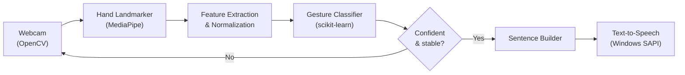

# Hand Gesture to Speech

**A real-time assistive communication system that converts webcam hand gestures into text and spoken sentences.**


```text
I  →  NEED  →  WATER   =   "I need water"   →   🔊 Speech output
```

<!-- Add a screenshot or demo GIF here (recommended):
<p align="center"></p>
-->

---

## Table of Contents

- [Overview](#overview)
- [Features](#features)
- [How It Works](#how-it-works)
- [Tech Stack](#tech-stack)
- [Project Structure](#project-structure)
- [Getting Started](#getting-started)
- [Usage](#usage)
- [Configuration](#configuration)
- [Model Performance](#model-performance)
- [Limitations](#limitations)
- [Roadmap](#roadmap)
- [Troubleshooting](#troubleshooting)
- [Contributing](#contributing)
- [License](#license)
- [Author](#author)

---

## Overview

Communication can be difficult for people with speech impairments. This project provides a simple, low-cost assistive tool: it watches a webcam, recognizes predefined hand gestures with computer vision and machine learning, chains them into sentences, and speaks the result aloud.

The system currently recognizes gestures for **I**, **Need**, **Water**, **Love** and **You**, which combine into sentences such as:

- *I need water*
- *I love you*

Beyond assistive communication, the same pipeline applies to human-computer interaction, accessibility technology and sign language research.

---

## Features

- **Real-time recognition** from a standard webcam
- **Hand landmark detection** with MediaPipe (21 points per hand, up to two hands)
- **Machine-learning classification** with a scikit-learn model
- **Sentence building** by chaining multiple gestures
- **Text-to-speech output** through Windows SAPI
- **Custom dataset collection** tool for adding your own gestures
- **Reliable predictions** through a confidence threshold and stable-frame detection
- **Persistent models** saved and loaded with Joblib

---

## How It Works



1. **Capture:** OpenCV reads frames from the webcam.
2. **Detect:** MediaPipe Hand Landmarker finds each hand and returns 21 landmarks.
3. **Extract and normalize:** landmarks become a fixed-length numeric feature vector (details below).
4. **Classify:** the trained scikit-learn model predicts the gesture and a confidence score.
5. **Validate:** a prediction is accepted only if it exceeds the confidence threshold and stays the same for several consecutive frames.
6. **Build the sentence:** accepted gestures are stored in order (`I` → `NEED` → `WATER`).
7. **Speak:** the final sentence is passed to the Windows text-to-speech engine.

### Feature vector

| Property | Value |
|---|---|
| Landmarks per hand | 21 |
| Values per landmark | 2 (normalized `x`, `y`) |
| Features per hand | 42 |
| Total vector length | **84** (left hand 42 + right hand 42) |
| Missing hand | Filled with zeros |
| Origin | Mean wrist position of the visible hand(s) |
| Scale | Largest `x`/`y` span across all visible landmarks |

Centering on the wrist and scaling by hand size makes recognition far less sensitive to **where** the hand is in the frame and **how far** it is from the camera.

---

## Tech Stack

| Technology | Purpose |
|---|---|
| Python | Core language |
| OpenCV | Webcam capture and drawing |
| MediaPipe | Hand landmark detection |
| scikit-learn | Gesture classification model |
| NumPy | Numerical operations |
| Pandas | Dataset handling |
| Joblib | Saving and loading trained models |
| Windows SAPI + PyWin32 | Text-to-speech output |

---

## Project Structure

```text
hand-gesture-to-speech/
├── Utilis.py              # Shared utilities (landmarker, features, drawing)
├── data_collection.py     # Record gesture samples from the webcam
├── train_model.py         # Train and save the classifier
├── gesture_to_speech.py   # Main real-time application
│
├── gesture_data.csv       # Collected dataset (generated)
├── gesture_model.joblib   # Trained model (generated)
├── gesture_labels.joblib  # Label mapping (generated)
├── hand_landmarker.task   # MediaPipe model (downloaded automatically)
│
├── requirements.txt
├── README.md
└── .gitignore
```

| File | Role |
|---|---|
| `Utilis.py` | Creates the MediaPipe Hand Landmarker, converts OpenCV frames to MediaPipe images, builds normalized feature vectors and draws hand landmarks. |
| `data_collection.py` | Records labeled landmark samples into `gesture_data.csv`. |
| `train_model.py` | Loads the dataset, trains the classifier and saves `gesture_model.joblib` and `gesture_labels.joblib`. |
| `gesture_to_speech.py` | Runs live recognition, sentence formation and speech output. |

---

## Getting Started

### Prerequisites

- Windows 10 or 11 (required for the Windows SAPI speech output)
- Python 3.9 – 3.12
- A working webcam

### Installation

```bash
# 1. Clone the repository
git clone https://github.com/Venuprasad04/hand-gesture-to-speech.git
cd hand-gesture-to-speech

# 2. Create and activate a virtual environment
python -m venv venv
venv\Scripts\activate

# 3. Install dependencies
pip install -r requirements.txt
```

Or install the packages directly:

```bash
pip install opencv-python mediapipe numpy pandas scikit-learn joblib pywin32
```

> The MediaPipe `hand_landmarker.task` model is downloaded automatically on first run. If you are offline, see [Troubleshooting](#troubleshooting).

---

## Usage

### 1. Collect gesture data

```bash
python data_collection.py
```

| Key | Action |
|---|---|
| `0`–`9` | Select the gesture to record |
| `SPACE` | Start / stop recording |
| `Q` | Quit |

Samples are saved to `gesture_data.csv`. Record each gesture from slightly different distances, angles and lighting conditions for best results.

### 2. Train the model

```bash
python train_model.py
```

This trains the classifier and writes `gesture_model.joblib` and `gesture_labels.joblib`.

### 3. Run the application

```bash
python gesture_to_speech.py
```

The webcam opens and recognition starts. Example session:

```text
Gesture 1: I
Gesture 2: NEED
Gesture 3: WATER

Sentence: I NEED WATER
🔊 "I need water"
```

---

## Configuration

| Setting | Default | Location | Effect |
|---|---:|---|---|
| `CONFIDENCE_THRESHOLD` | `0.60` | `gesture_to_speech.py` | Minimum model confidence to accept a prediction. |
| `STABLE_FRAMES_REQUIRED` | `4` | `gesture_to_speech.py` | Consecutive frames a gesture must hold before it is accepted. |
| `min_hand_detection_confidence` | `0.65` | `Utilis.py` | MediaPipe palm-detection threshold. |
| `min_hand_presence_confidence` | `0.65` | `Utilis.py` | MediaPipe hand-presence threshold. |
| `min_tracking_confidence` | `0.65` | `Utilis.py` | MediaPipe tracking threshold. |
| `num_hands` | `2` | `Utilis.py` | Maximum hands detected per frame. |

**Tuning tip:** if predictions flicker or fire accidentally, raise `CONFIDENCE_THRESHOLD` or `STABLE_FRAMES_REQUIRED`. If the system feels slow to respond, lower them.

---

## Model Performance

Results from the initial training run on the **I**, **Need** and **Water** gestures:

| Gesture | Precision | Recall | F1 Score |
|---|---:|---:|---:|
| I | 1.00 | 0.98 | 0.99 |
| Need | 1.00 | 0.99 | 0.99 |
| Water | 0.97 | 1.00 | 0.99 |

**Overall accuracy: ~99%**

> Accuracy depends on lighting, camera quality, hand position, dataset size and the user. Results on a new person or a new environment may be lower than on the data the model was trained on, so retrain with samples from your own setup.

---

## Limitations

- **Windows only for speech:** text-to-speech uses Windows SAPI. The recognition pipeline itself is cross-platform.
- **Fixed vocabulary:** only the gestures present in the training data are recognized.
- **Static gestures:** each gesture is classified from a single pose, so motion-based signs are not supported yet.
- **Environment sensitivity:** poor lighting, busy backgrounds or partially hidden hands reduce accuracy.
- **Not a complete sign language translator.** It is a gesture-driven communication aid.

---

## Roadmap

- [ ] Larger gesture vocabulary
- [ ] Two-hand gesture vocabulary (the feature pipeline already supports two hands)
- [ ] Dynamic (motion-based) gestures with LSTM/CNN models
- [ ] Full sign language recognition
- [ ] Cross-platform text-to-speech
- [ ] Multilingual speech output
- [ ] Automatic sentence generation
- [ ] Emergency communication mode
- [ ] Web and Android versions
- [ ] Integration with smart assistive devices

---

## Troubleshooting

**The webcam does not open**
Close other apps that use the camera. If you have several cameras, change the index passed to `cv2.VideoCapture`.

**`ModuleNotFoundError: No module named 'win32com'`**
Install PyWin32: `pip install pywin32`.

**The model download fails (offline or blocked network)**
Download the file manually and place it in the project root as `hand_landmarker.task`:

```text
https://storage.googleapis.com/mediapipe-models/hand_landmarker/hand_landmarker/float16/1/hand_landmarker.task
```

**Predictions are inaccurate**
Record more samples per gesture in varied lighting, distances and angles, then run `train_model.py` again.

**Gestures trigger by accident**
Increase `CONFIDENCE_THRESHOLD` or `STABLE_FRAMES_REQUIRED` (see [Configuration](#configuration)).

---

## Contributing

Contributions, bug reports and suggestions are welcome.

1. Fork the repository
2. Create a feature branch: `git checkout -b feature/your-feature`
3. Commit your changes: `git commit -m "Add your feature"`
4. Push the branch: `git push origin feature/your-feature`
5. Open a Pull Request

---

## License

This project is developed for educational and research purposes. See the `LICENSE` file for details if one is included.

---

## Author

Developed by **[Venuprasad S K]** as an AI/ML and Computer Vision project focused on accessible communication through hand gesture recognition.

If you find this project useful, please consider giving it a ⭐ on GitHub.

**Acknowledgements:** [MediaPipe](https://developers.google.com/mediapipe), [OpenCV](https://opencv.org/) and [scikit-learn](https://scikit-learn.org/).